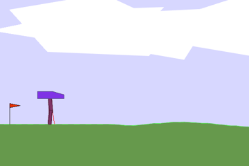

# Deep Reinforcement Learning

Two agents that learn by trial and error: one teaches a robot to walk, the other plays Doom.

| [Walking robot (PPO)](ppo) | [Doom agent (imitation + Double DQN)](doom) |
|---|---|
|  |  |
| Learns to walk across uneven ground. Scores about 290 of a possible ~300. | Learns to fight bots in a Doom deathmatch from raw screen images. Scored 184.5 on the course server, where the top grade started at 120. |

Built for the *Deep Reinforcement Learning* course at Johannes Kepler University Linz (2026). Each folder has its own README with details and run instructions.
