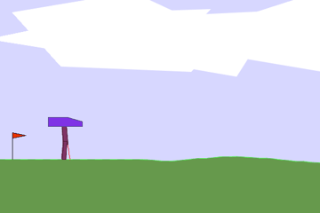
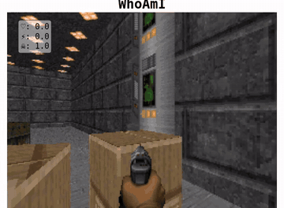

# Deep Reinforcement Learning

Two agents that learn by trial and error: a robot that learns to walk, and a Doom player that learns to fight.

| [Walking robot (PPO)](ppo) | [Doom agent (imitation learning + Double DQN)](doom) |
|---|---|
|  |  |
| Learns to cross uneven ground. Reaches the end in 96 of 100 test runs. | Learns to fight bots in a Doom deathmatch from screen pixels. |

Projects from the *Deep Reinforcement Learning* course at Johannes Kepler University Linz. Each folder has its own README.
