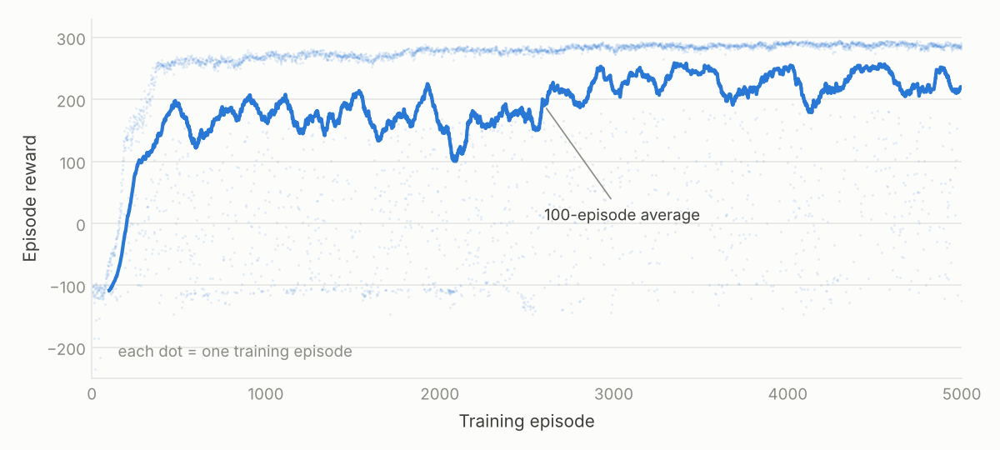

# Walking Robot with PPO


[BipedalWalker](https://gymnasium.farama.org/environments/box2d/bipedal_walker/) is a two-legged robot that has to cross uneven ground. The agent sets the torque of its four joints at every step. It is rewarded for moving forward, pays for the energy it uses and loses 100 points if it falls. Reaching the far end is worth about 300 points.

## Method

Proximal Policy Optimization (PPO), an actor-critic method:

- **Actor:** a network with two hidden layers of 128 units that outputs a Gaussian distribution over the four joint torques.
- **Critic:** a network of the same size that estimates how much reward to expect from the current state.
- **Advantages** with Generalized Advantage Estimation (λ = 0.95), normalized per batch.
- **Updates:** after every ~2,000 collected steps, 10 passes over the data with the clipped PPO loss (ε = 0.2), a value loss and an entropy bonus.

## Results

Tested on 100 runs with random terrain, the trained agent reaches the end in **96 of 100** (median score **299**, mean 291.5).



Training takes about 10 minutes on a laptop CPU. The agent first reaches the end around episode 360. After that, the runs that reach the end keep improving, from about 255 to about 290 points, because the robot learns to walk faster and with less energy. The low dots are falls caused by the random actions the agent samples while training.

One setting mattered most: the episode time limit. With episodes cut at 400 steps, the agent only practised the first quarter of the course and averaged 181 ± 120 over 20 test runs. With the full 1,600 steps it averaged 299 ± 0.6.

## How to run

```bash
pip install -r requirements.txt

python evaluate.py model.onnx                    # test the trained agent (20 runs)
python evaluate.py model.onnx --gif walker.gif   # also save a GIF of the first run
python train.py                                  # train a new agent, saved to runs/ppo
python evaluate.py runs/ppo/best.pth             # test your own agent
```

Hyperparameters are set at the top of `train.py`. If installing Box2D fails on macOS, run `brew install swig` first.

## Files

- `model.py`: actor and critic networks
- `train.py`: rollout buffer, PPO update and training loop
- `evaluate.py`: runs an agent from an `.onnx` or `.pth` file and reports its score
- `model.onnx`: the trained agent shown above
